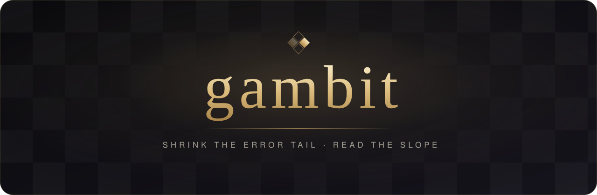
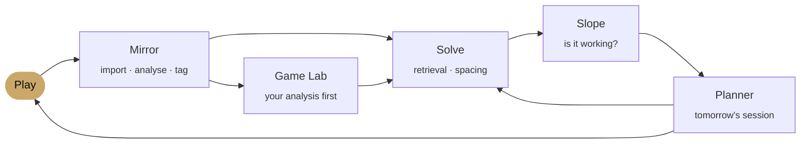

<p align="center">
  
</p>

<p align="center">
  <em>A private chess tutor for macOS, built for one player.</em><br>
  <sub>It turns every mistake you make into a pattern you'll never miss again.</sub>
</p>

<p align="center">
  
  
  
  
  
  
</p>

<br>

## The idea

Below master level, a chess rating mostly measures **how rarely you make big mistakes**. Blunders fall roughly by half for every 600 rating points, and most of that strength is fast recognition, not deeper calculation.

So gambit does three things:

<table>
  <tr>
    <td width="30%"><b>Shrink the error tail</b></td>
    <td>Every blunder in your games becomes a position you solve cold, in many variations, on a spaced schedule, until the pattern is automatic.</td>
  </tr>
  <tr>
    <td><b>Games are tests, not training</b></td>
    <td>Study beats play roughly 3.6× per hour. gambit spends your hours on solving, analysis and endgames, and uses games to measure.</td>
  </tr>
  <tr>
    <td><b>Read the slope</b></td>
    <td>Rating is noisy (±40 points is nothing). gambit tracks rolling averages per games played, blunders per game, clock use and the rating band your moves resemble.</td>
  </tr>
</table>

<br>

## The loop



<br>

## Features

<table>
  <tr>
    <td width="50%" valign="top">
      <h4>◆ Mirror</h4>
      Pulls every game from Chess.com and Lichess and analyses each move with Stockfish. Tags blunders, motifs, game phase and clock use.
    </td>
    <td width="50%" valign="top">
      <h4>◆ Solve</h4>
      Positions from your own mistakes and the Lichess puzzle library. You commit to a move and a line before anything is revealed. Mixed sets, many variations of each motif, FSRS review.
    </td>
  </tr>
  <tr>
    <td valign="top">
      <h4>◆ Calculation</h4>
      The pieces stay frozen while you write your candidates and main line, then the engine checks them. Includes a visualization mode and a "look somewhere else once" step.
    </td>
    <td valign="top">
      <h4>◆ Game Lab</h4>
      The engine stays locked until you've annotated the game yourself. Then Stockfish and Maia compare your moves with stronger players'. Each session ends with 1–3 lessons logged, and the file closes.
    </td>
  </tr>
  <tr>
    <td valign="top">
      <h4>◆ Endgames</h4>
      The key theoretical positions, played against perfect tablebase defence and reviewed on a schedule.
    </td>
    <td valign="top">
      <h4>◆ Openings</h4>
      A narrow repertoire built from your own games. It flags where you left your preparation and reviews only the lines that matter.
    </td>
  </tr>
  <tr>
    <td valign="top">
      <h4>◆ Sparring</h4>
      Play Maia-3 locally at long time controls, set just above your level. It makes human mistakes, not engine moves.
    </td>
    <td valign="top">
      <h4>◆ Slope</h4>
      Rating per games played with the noise band shaded, blunders per game, clock profile, rating-band resemblance and progress gates.
    </td>
  </tr>
  <tr>
    <td valign="top">
      <h4>◆ Planner</h4>
      Daily sessions split by stage-based allocations. Time-boxed, varied, with rest days. No streaks and no quotas.
    </td>
    <td valign="top">
      <h4>◆ Coach</h4>
      A Claude-powered weekly review and plain-language explanations, grounded in engine output. It never invents an evaluation.
    </td>
  </tr>
</table>

<br>

## Principles

- **Fair play, always.** All engine, Maia and coach features switch off while a live game is in progress. Analysis runs on finished games only.
- **Effort over fluency.** Solve first, reveal later. A session that feels hard is usually the one that worked.
- **Bounded by design.** Hard time limits, stopping rules for post-mortems, and a stop after a run of losses. Thoroughness gets a stopping point.
- **Local and private.** Your games, notes and progress live in SQLite on your Mac. The only network calls go to Lichess, Chess.com and the Claude API.
- **Premium or nothing.** A board, type and motion you want to spend 30 hours a week with. See [`docs/DESIGN.md`](docs/DESIGN.md).

<br>

## Architecture

```
┌──────────────────────────── gambit.app (Tauri 2) ────────────────────────────┐
│                                                                              │
│   UI   React · TypeScript · chessground · chessops                           │
│        ──────────────────── JSON-RPC over a localhost WebSocket ────────────  │
│   Brain (Python 3.12)                                                        │
│        python-chess · Stockfish 19 (UCI) · Maia-3 (PyTorch, MPS) · FSRS      │
│        SQLite  ── games · positions · reviews · sessions · metrics           │
│                                                                              │
└──────────────┬───────────────────────┬───────────────────────┬───────────────┘
               │                       │                       │
        Chess.com public API     Lichess API (token)      Claude API (Keychain)
        monthly PGN archives     games · puzzles ·        weekly review ·
                                 tablebase · explorer     explanations
```

<br>

## Roadmap

- [x] **v0.1 · Mirror.** Game import, batch analysis, slope dashboard, one-time history audit
- [x] **v0.2 · Solve.** Positions from your own blunders + Lichess puzzle library, solve-first, FSRS review
- [x] **v0.3 · Game Lab.** Engine-locked post-mortems, Maia comparison, fair-play lock, guardrails
- [x] **v0.4 · Train.** Daily planner, endgame trainer, Maia sparring
- [x] **v0.5 · Deepen.** Calculation trainer, openings, master games, Claude coach, calibration tests

The full plan is in [`docs/PLAN.md`](docs/PLAN.md).

<br>

## Repository

```
gambit/
├── app/           Tauri 2 shell (src-tauri/) and React UI (src/)
├── brain/         Python 3.12 brain: storage, importers, Stockfish, metrics
├── bakeoff/       stack bake-off: benchmarks, results and the board spike
├── assets/        brand assets
├── docs/
│   ├── PLAN.md    product plan, build notes and build order
│   └── DESIGN.md  design language and quality bar
├── CLAUDE.md      working notes for AI-assisted development
└── README.md
```

Running it needs `uv`, Node 24, Rust and `brew install stockfish`:

```bash
cd brain && uv sync && cd ../app && npm install && npm run tauri dev
```

<br>

<p align="center">
  <sub>Personal software. Not for distribution. © 2026 Kanishk Paul.</sub>
</p>
